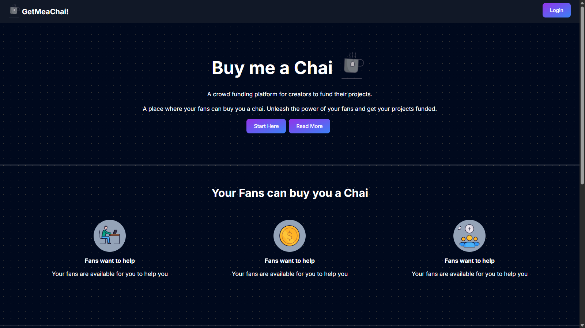
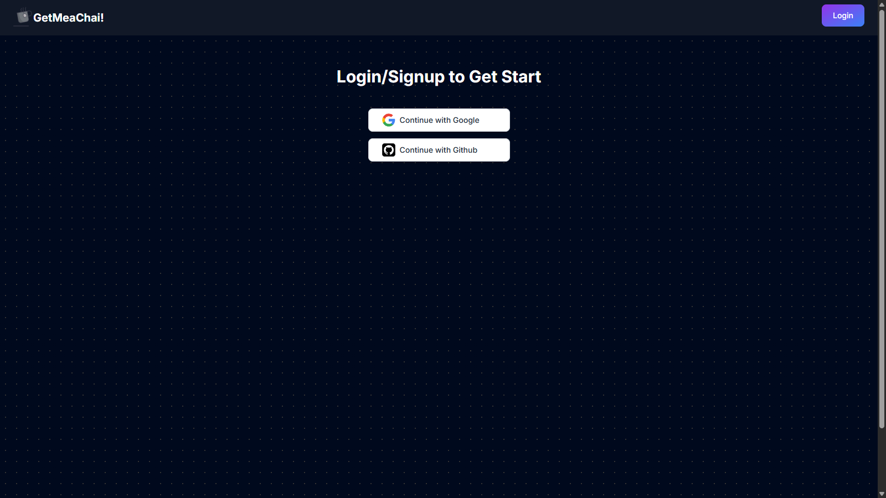
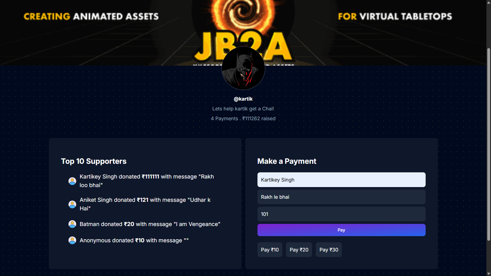
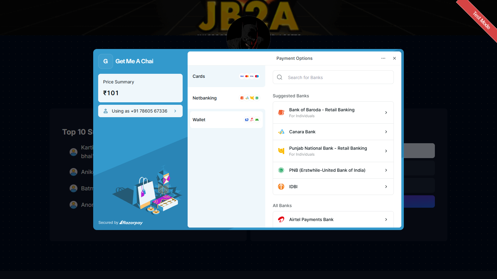
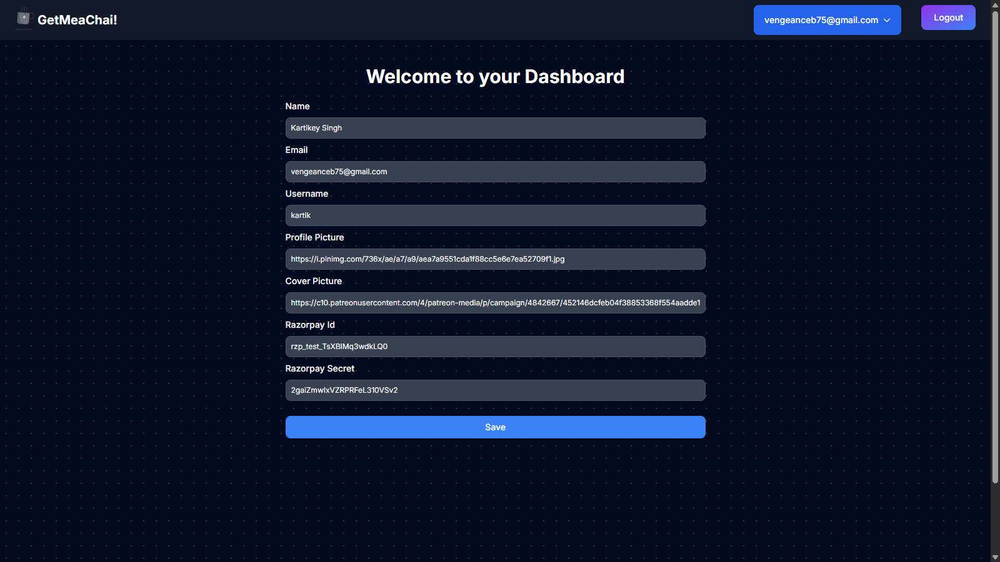

# GetMeAChai!

A crowdfunding platform enabling creators to accept payments from fans and process payouts using their own Razorpay credentials.

---

## About

| Landing Page | OAuth Login |
| :---: | :---: |
|  |  |

| Creator Profile & Support | Razorpay Checkout | Dashboard Settings |
| :---: | :---: | :---: |
|  |  |  |

---

## Features

- **OAuth Authentication**: Login via Google and GitHub.
- **Razorpay Integration**: Direct fan funding and creator payment processing using personal Razorpay credentials.
- **Creator Profiles**: Live leaderboards and supporter messages.
- **User Dashboard**: Manage profile details and API credentials.
- **Database**: Real-time user & transaction tracking via MongoDB.

---

## Tech Stack

**Next.js** • **Tailwind CSS** • **NextAuth.js** • **MongoDB** • **Razorpay**

---

## Quick Start

1. **Clone & Install**
   ```bash
   git clone [https://github.com/kartikey2414/get-me-a-chai.git](https://github.com/kartikey2414/get-me-a-chai.git)
   cd get-me-a-chai
   npm install